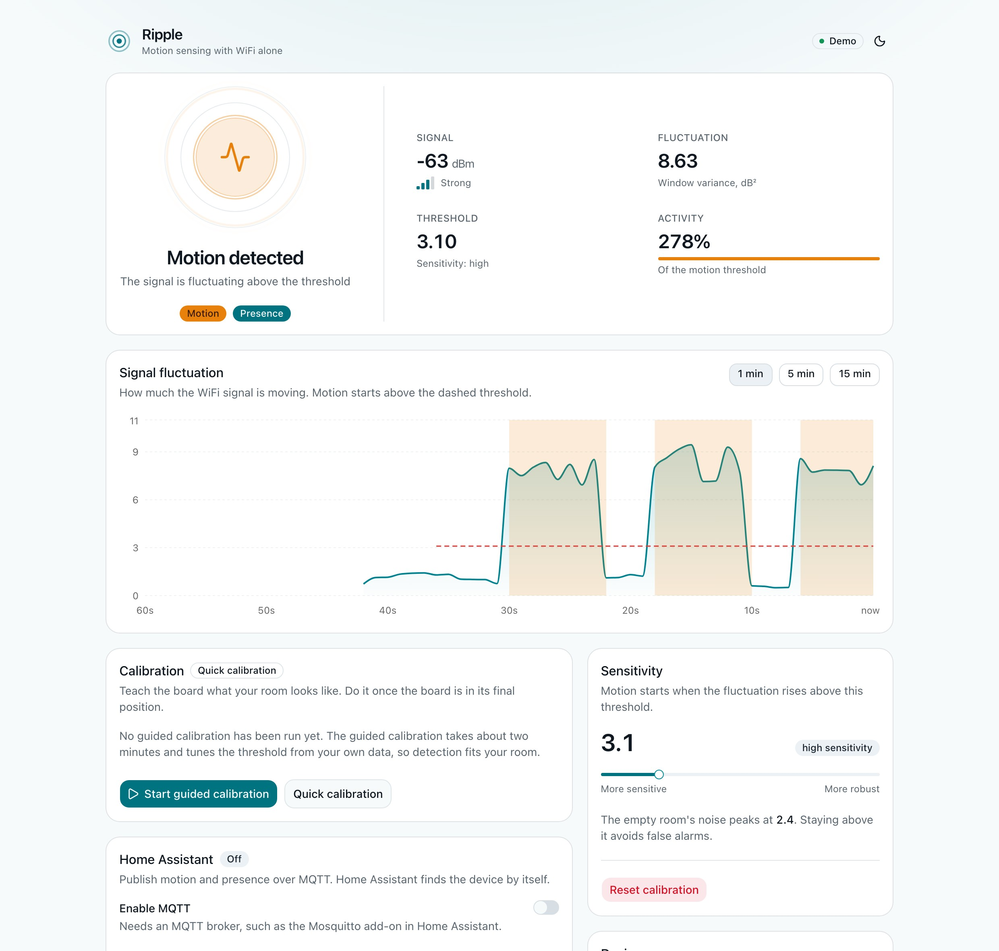
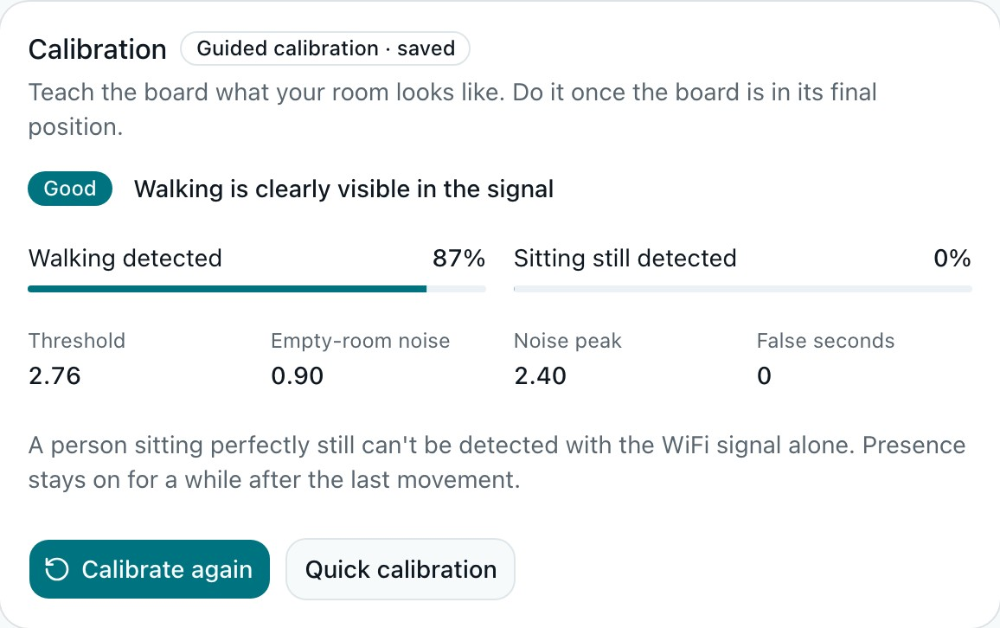
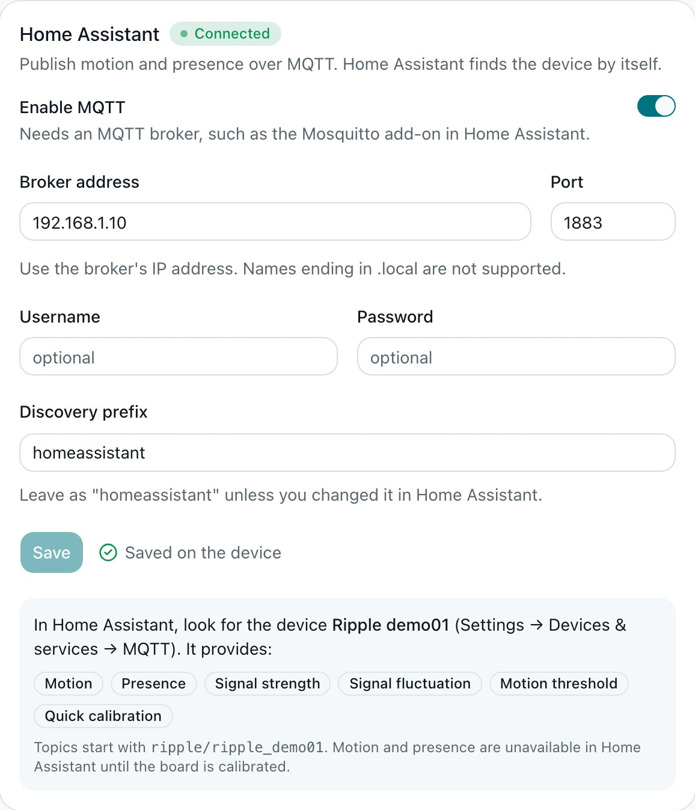

<div align="center">

# Ripple

**Motion and presence sensing with nothing but WiFi.**<br>
Turn a ~€3 ESP8266 into a motion sensor: no camera, no PIR, no extra hardware.

[](https://github.com/adrianoamalfi/ripple/actions/workflows/ci.yml)
[](https://github.com/adrianoamalfi/ripple/releases)
[](LICENSE)

[**Live demo**](https://adrianoamalfi.github.io/ripple/demo/) ·
[**Install from your browser**](https://adrianoamalfi.github.io/ripple/install/) ·
[Documentation](docs/)

<picture>
  <source media="(prefers-color-scheme: dark)" srcset="docs/images/dashboard-dark.jpg">
  
</picture>

</div>

## What is this?

A body moving through a room disturbs the 2.4 GHz radio waves bouncing around it,
so the signal strength (RSSI) between your ESP8266 and your router fluctuates more
than usual. Ripple measures that fluctuation about ten times a second, learns what
*your* empty room looks like, and reports **motion** when the signal moves more
than it should. A **presence** state stays on for a while after the last movement.

It runs entirely on the board: no cloud, no account, no extra sensor. You watch it
on a web dashboard served by the board itself, and it plugs into **Home Assistant**
over MQTT with automatic discovery.

## Features

- **Guided calibration.** Four short steps (leave the room, walk around, sit still,
  leave again) tune the threshold from *your* room and tell you honestly whether
  walking can be told apart from an empty room at that spot.
- **A real dashboard.** Live signal chart, threshold, calibration, sensitivity and
  MQTT settings. Light and dark themes, works on a phone. Served from the board,
  no internet needed. [Try it in your browser](https://adrianoamalfi.github.io/ripple/demo/)
  with a simulated board.
- **Home Assistant, no YAML.** MQTT discovery creates a device with motion,
  presence, signal, fluctuation, a threshold you can change and a calibration
  button. See [Home Assistant](docs/home-assistant.md).
- **No hard-coded WiFi.** On first boot the board opens a setup network
  (`Ripple-xxxxxx`) with a captive portal where you pick your WiFi. See
  [Getting started](docs/getting-started.md).
- **Resilient.** Calibration and settings survive reboots; a broker that is down
  never stalls the sensor; if your router is slow to come back after a power cut,
  the board reconnects by itself.
- **Open and tested.** MIT licensed, with unit tests for the algorithm, the
  calibration wizard and the Home Assistant messages, and CI on every change.

<p align="center">
  
  
</p>

## Quick start

**Easiest: install from your browser.** Plug the board in over USB and open the
[installer](https://adrianoamalfi.github.io/ripple/install/) in Chrome or Edge.
Then join the `Ripple-xxxxxx` WiFi network the board opens, choose your WiFi, and
open `http://ripple-xxxxxx.local/`.

**Or build it yourself** with [PlatformIO](https://platformio.org/):

```bash
git clone https://github.com/adrianoamalfi/ripple.git && cd ripple
pio run -e nodemcuv2 -t upload      # or d1_mini / esp12e
```

Full walkthrough, including calibration and Home Assistant:
**[docs/getting-started.md](docs/getting-started.md)**.

## Honest limitations

The ESP8266 only exposes an integer RSSI, not the richer channel data (CSI) the
ESP32 offers. In practice:

- It detects **movement** well. A person sitting perfectly still is **not**
  detectable, which is why presence is "movement within the last 30 seconds".
- Sensitivity depends on **where the board sits** relative to the router and on
  the room. Right next to the router the signal is so stable that walking can be
  invisible; 4–6 m away, with people crossing the line between the two, works much
  better. The calibration wizard tells you when a position is poor.
- Pets, fans, other people and other WiFi devices all move the signal.
- It is a convenience sensor, not a security device.

More in [docs/calibration.md](docs/calibration.md) and
[docs/troubleshooting.md](docs/troubleshooting.md).

## Hardware

Any ESP8266 board with **4 MB of flash**: NodeMCU v2/v3, Wemos/LOLIN D1 mini, or a
generic ESP-12E/F module. (1 MB boards such as the ESP-01 don't have room for the
dashboard.) Power it with a USB charger near where you want to sense.

## Documentation

| | |
|---|---|
| [Getting started](docs/getting-started.md) | Install, first-time WiFi setup, calibration |
| [Calibration](docs/calibration.md) | How the guided calibration works and how to place the board |
| [Home Assistant](docs/home-assistant.md) | MQTT, entities, automations |
| [API reference](docs/api.md) | REST, WebSocket, MQTT topics, serial commands |
| [Architecture](docs/architecture.md) | How the firmware and the algorithm are built |
| [Troubleshooting](docs/troubleshooting.md) | When something doesn't work |
| [Development](docs/development.md) | Build, test, release, contribute |

## Status

Early but working: `v0.1.0` is a pre-release. Planned next: signed over-the-air
firmware updates (for now update over USB or with the web installer), a password
for the dashboard, and an adjustable presence timeout. See the
[changelog](CHANGELOG.md) and the [issues](https://github.com/adrianoamalfi/ripple/issues).

> **Security note.** The dashboard has no password yet: anyone on your network
> can open it and change settings. Don't expose the board to the internet. During
> first-time setup the board's setup network is open (no password), as is usual for
> this kind of device.

## Contributing

Bug reports, photos of your setup, real-world results and pull requests are very
welcome. Start with [CONTRIBUTING.md](CONTRIBUTING.md).

## License

[MIT](LICENSE) © Adriano Amalfi
